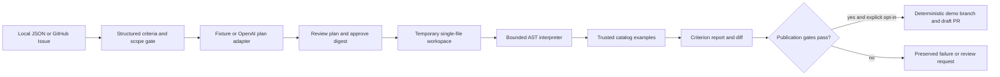

# Architecture and decisions

Python standard library keeps the workflow inspectable: argparse, urllib, ast,
tempfile, unittest and JSON. A single model adapter avoids premature provider
abstraction. One model request proposes both the plan and expression, reducing
cost and making approval bind exactly what will be changed. The model does not
select tests or assess its own success.

The shipping domain makes boundaries and negative cases legible in an interview.
Exact catalog criteria favor trustworthy verification over broad but unsupported
claims of autonomy. New domains need reviewed adapters, criteria mappings and
tests. The AST language sacrifices general code generation to keep untrusted code
execution disabled without requiring Docker. It is not an autonomous coding agent.

Plan/approval/run/report are explicit artifacts. SHA256 binds approval to plan;
run ID binds plan to source bytes. Failed reports are retained; identical execution
returns existing results. Publication recomputes evidence, checks remote source
hash and uses a deterministic branch plus all-state PR lookup. No force updates.
The draft PR body contains actual example inputs/outputs, file location and diff.

Limits: no UI, arbitrary repositories from issue text, dependency changes, repair
loops, external services beyond GitHub/OpenAI, arbitrary generated Python execution,
or exhaustive correctness guarantees. Local operator/config is trusted. GitHub
lists are bounded to 100 results; very large repositories may need pagination
before use. Concurrent publication from different machines can fail at ref/PR
creation; fail closed and inspect rather than overwrite. The local lock only
coordinates runs sharing a run directory. See [security](SECURITY.md).

AI helped draft implementation, tests and documentation. Engineering choices were
to constrain scope, separate model proposals from verification, bind approval,
test negative outcomes, and keep measured evidence distinct from assertions.
The operator remains responsible for review and for any broader deployment.
